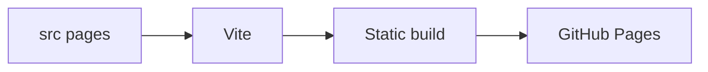

# Portfolio site

Personal site for Pranav Reveendran. React, TypeScript, and Vite. One page: hero, about, selected work, a tech-stack archive, experience, projects, and contact. The entry is `src/studio/Studio.tsx`. The repositories are the work.



## Develop

```bash
npm install
npm run dev
```

## Production build

```bash
npm run build
npm run preview
```

`npm run build` writes the static bundle. `npm run preview` serves that bundle locally so you can check the production output before it is published. Content edits belong in the page components, not in a generated folder.

## What this signals

A maintained front door: typed React, a real build, and a place the project links can live without turning the GitHub profile into a second website.
